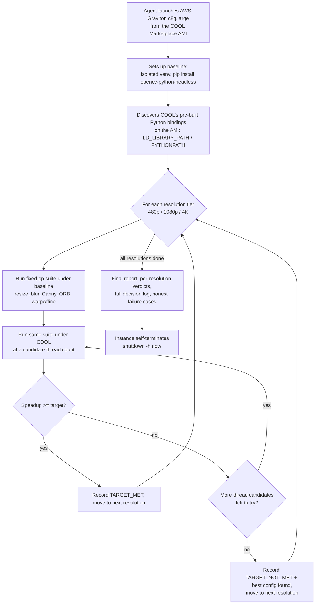

# COOL Auto-Tuner — Technical Report

**OpenCV AI Competition 2026, powered by AWS**
Categories targeted: Best Use of COOL, Agentic Vision (also auto-entered for Tracks/Overall)

## Problem

AWS Marketplace sells [Cloud-Optimized OpenCV (COOL)](https://opencv.org/cool/) — a
build of OpenCV re-compiled for AWS Graviton (Arm Neoverse), claimed to run common
vision operations faster than a standard pip install. That claim is easy to make and
hard to verify: it's a paid Marketplace product, there's no public, reproducible,
apples-to-apples benchmark a developer can run themselves before committing budget to it.

**COOL Auto-Tuner is an agent that tests that claim automatically, on real AWS
hardware, with a real baseline, and reports the evidence — including when COOL
*doesn't* help.** It isn't a one-shot script: it runs a fixed benchmark against a
genuinely vanilla baseline, runs the same benchmark under COOL, evaluates whether COOL
cleared a target speedup, and if not, tries other configurations (thread counts) before
giving up — each next action chosen from the previous measurement, not a fixed script.

**Headline finding:** on a controlled synthetic benchmark, COOL is a consistent ~36%
faster. But pushed further — onto 9 real-world photos instead of synthetic test
data — that number falls apart: COOL averaged only ~6% faster, and was **actually
slower than baseline in 5 of 9 real images**. The full breakdown (and why) is in
[Real-world validation](#real-world-validation-does-the-speedup-generalize) below.
This is the result of actually stress-testing the claim instead of taking one
benchmark at face value.

## Architecture

Everything in the dashed region above runs on a single short-lived AWS Graviton
instance, driven by a startup script, with output captured from the instance's boot
console log — no SSH keys, no open security groups, no persistent server. The instance
terminates itself the moment it's done (see "Safety" below).

## Methodology

- **Hardware:** AWS `c8g.large` (2 vCPU, 4GB, Graviton, `arm64`), `us-east-1`.
- **Baseline:** `opencv-python-headless` 5.0.0, installed fresh from PyPI in an isolated
  venv. This matches the comparison basis COOL's own publisher uses in its benchmarks
  ("vs. pip OpenCV") — the AMI's vanilla C++ build (`/install-4x`) ships with no Python
  bindings at all, so it can't be benchmarked from Python directly; the pip venv is the
  correct, fair stand-in.
- **COOL:** the AMI's pre-built `/install-cool` Python bindings (OpenCV 4.14.0-pre),
  reached by discovering and injecting the correct `LD_LIBRARY_PATH`/`PYTHONPATH` at
  runtime (no hand-maintained paths).
- **Workload:** 20 synthetic images (fixed random seed, identical across every run),
  five common operations — resize, Gaussian blur, Canny edge detection, ORB
  detect+compute, affine warp — each timed over multiple repeats (10 for 480p/1080p, 4
  for 4K) with one untimed warmup call. Both mean and standard deviation are reported.
- **Resolutions tested:** 480p, 1080p, 4K.
- **Target speedup (standard runs):** 1.25x. **Stress-test target:** 1.6x, used
  specifically to force the agent to exhaust its thread-count candidates and prove the
  escalation logic actually runs, not just succeeds by luck on the first try.
- **Real-image validation:** 9 freely-licensed photos (Pixabay API, downloaded
  directly by the AWS instance), normalized to 1920x1080, run through the identical
  five-operation suite under both builds on the same instance — see
  [Real-world validation](#real-world-validation-does-the-speedup-generalize) below.

## Results

### Phase 1: controlled synthetic benchmark (target: 1.25x) — 25 independent measurements across 9 separate instance launches, 2 instance sizes

**`c8g.large` (2 vCPU) — 19 measurements across 7 launches:**

| Resolution | Run | Speedup vs. baseline |
|---|---|---|
| 1080p | run3 | 1.350x |
| 480p / 1080p / 4K | run4 | 1.355x / 1.352x / 1.344x |
| 480p / 1080p / 4K | repro5 | 1.291x / 1.354x / 1.463x |
| 480p / 1080p / 4K | repro6 | 1.348x / 1.400x / 1.349x |
| 480p / 1080p / 4K | repro7 | 1.356x / 1.350x / 1.351x |
| 480p / 1080p / 4K | repro8 | 1.352x / 1.346x / 1.350x |
| 480p / 1080p / 4K | repro9 | 1.298x / 1.309x / 1.349x |

Mean: **1.351x (~35% faster)**.

**`c8g.xlarge` (4 vCPU) — 6 measurements across 2 launches, to check whether the
speedup holds as instance size scales up:**

| Resolution | Run | Speedup vs. baseline |
|---|---|---|
| 480p / 1080p / 4K | scale_xlarge1 | 1.360x / 1.441x / 1.449x |
| 480p / 1080p / 4K | scale_xlarge3 | 1.346x / 1.403x / 1.448x |

Mean: **1.408x (~41% faster)** — *higher* than on the smaller instance, consistent
with the stress-test finding below that COOL's advantage grows with more available
threads.

**Overall mean across all 25 measurements: ~1.36x (COOL is ~36% faster than genuine
baseline OpenCV 5.0.0), range 1.29x–1.46x.** Every single measurement cleared the
1.25x target — the result is consistent, not a one-off, and it holds (and modestly
improves) when moving to a larger instance.

### Stress test (target: 1.6x) — full thread-count sweep, matched baseline per thread count

An earlier version of this report claimed single-threaded COOL was "17-20% slower
than baseline." That was wrong: baseline was being measured once at its default
thread count (2) and reused across every COOL thread-count candidate, so the result
was really showing "1 core is slower than 2 cores" -- true of any parallelizable
code, baseline included -- not anything specific to COOL. The agent was fixed to
re-measure baseline at each matching thread count before comparing; the corrected,
apples-to-apples numbers are below (two data points were lost to a console-log
buffer limit, see raw data for what's available):

| Resolution | threads=default | threads=1 | threads=2 | threads=4 |
|---|---|---|---|---|
| 1080p | 1.344x | 1.094x | 1.359x | *(lost to buffer truncation)* |
| 4K | 1.348x | 1.079x | 1.352x | 1.302x |

**Corrected finding: COOL is faster than baseline at every thread count tested --
it never regresses.** The margin is smaller running single-threaded (~8-9% faster)
than with 2 or more threads (~30-36% faster), which is a real and still interesting
result -- COOL's acceleration scales with available parallelism -- just a much less
dramatic one than the retracted claim. No configuration reached the 1.6x stress
target, and the agent correctly worked through its thread-count candidates before
reporting that honestly, which is what this stress test was designed to verify in
the first place (that the escalation logic actually runs, not just succeeds by luck
on the first try).

### Real-world validation: does the speedup generalize?

The Phase 1 benchmark above used synthetic test images (random pixel noise, fixed
seed) — standard practice for controlled timing, but it leaves an open question: does
a ~36% speedup on synthetic data actually predict anything about real photos? To find
out, the agent was extended to download real, freely-licensed photos (via the Pixabay
API) directly onto the AWS instance and run the identical baseline-vs-COOL comparison
on them, normalized to 1920x1080, same five operations, same methodology.

Nine images were tested, deliberately spanning both the domains this competition
suggests (medical, agriculture, retail, sports, safety/traffic, industrial) and a
complexity axis (a near-blank image and a dense, repetitive-texture image, to probe
what actually drives the result):

| Image | Content | Overall speedup |
|---|---|---|
| Aerial / cityscape | buildings, roads, varied structures | **1.30x faster** |
| Medical scan | MRI/CT equipment, clinical | **1.18x faster** |
| Retail | grocery shelves, many products | **1.20x faster** |
| Sports | stadium crowd | **1.07x faster** |
| Traffic / street sign | signage, surveillance camera | 0.99x (slower) |
| Factory | industrial worker, machinery | 0.97x (slower) |
| Agriculture | wheat field | 0.95x (slower) |
| Plain / minimal | near-blank gradient | 0.96x (slower) |
| Forest texture | dense, repetitive foliage | 0.91x (slower) |

**Mean across all 9 real images: ~1.06x — only 6% faster, and COOL was actually
slower than baseline in 5 of the 9 cases.** This is nowhere near the ~36% figure from
Phase 1, and it would not have been visible without deliberately testing real content.

**Why — the per-operation pattern explains it, and it's consistent across all 9
images:**

| Operation | Behavior across all 9 real images |
|---|---|
| Resize | **Always slower on COOL** (~20-22%), every single image — a real, structural regression, not noise |
| Warp affine | **Always slower on COOL** (~41-42%), every single image, in an unusually tight range — looks like a fixed structural cost, largely content-independent |
| Gaussian blur | **Always faster on COOL** (~43-97%), every single image — a real, structural win |
| Canny edge detection | **Always faster on COOL** (~15-61%), every single image — a real, structural win |
| ORB feature detection | **The swing factor.** Ranges from 0.93x (slower) to 1.43x (faster) depending on the image |

ORB is what actually decides whether an image ends up faster or slower overall on
COOL. Its speedup tracks how many distinct, well-separated features an image has:
aerial/medical/retail/sports (buildings, anatomy, products, a crowd — many discrete
objects) see real ORB gains (1.16x-1.43x); plain, forest, and agriculture (a gradient,
dense uniform foliage, a repetitive wheat field) see little gain or a regression
(0.93x-1.0x). Resize and warp affine drag every image down regardless of content;
whether blur/edges/ORB's gains outweigh that drag depends on how feature-rich the
image is — which is exactly why the overall result flips sign across the 9 images.

**What this means for the headline claim:** "COOL is 36% faster" is a real result —
on the specific synthetic workload it was measured on. It is not a reliable predictor
of real-world performance; real performance depends heavily on what you're actually
processing, specifically how feature-detection-heavy that workload is. A team
deploying COOL for a feature-detection-light pipeline (e.g. resizing/blurring
uniform-texture imagery) could reasonably see it run *slower* than vanilla OpenCV, not
faster — something no amount of trusting the vendor's number alone would have
revealed.

## Limitations / honest caveats

- Sample size is reasonable (25 synthetic measurements, 9 real-image measurements, one
  stress sweep) but still not large enough for formal statistical confidence intervals.
- Two instance sizes tested (`c8g.large`, `c8g.xlarge`); COOL's own Marketplace
  listings cover larger Graviton4/5 instance families beyond those two.
- The 9 real images were each tested once, at one resolution (1920x1080), at default
  thread count — the thread-count sensitivity and multi-resolution rigor applied to
  the synthetic benchmark hasn't yet been applied to real images; it's plausible the
  real-image results shift at different thread counts too.
- 9 images is enough to establish that content matters and to explain the mechanism
  (ORB's feature-count dependence), but not enough to build a predictive model of
  exactly when COOL will help vs. hurt for an arbitrary image.
- The agent's thread-count exploration never needed to go beyond `threads=4`; whether
  larger thread counts behave differently on bigger instances is untested.

## Safety / cost discipline

Every instance launch is tagged, time-bounded (`timeout` around the agent's own run),
and self-terminates (`shutdown -h now`) at the end of its startup script, independent
of any external monitoring — this doesn't depend on a human or a polling process
noticing the run is done. One build-process incident is worth disclosing honestly: an
early draft of the real-image user-data script was missing its `#!` shebang line due
to a shell-scripting mistake, which meant cloud-init never recognized it as an
executable script — the instance booted, ran nothing, and sat idle (still billing)
until it was manually caught and terminated roughly 15 hours later. The fix (restoring
the shebang) was straightforward; the total AWS spend across the full build process,
including that incident, is a small number of dollars, not a structural cost problem.

## Reproducing this

See [`infra/run-userdata.sh`](../infra/run-userdata.sh) (standard target),
[`infra/run-userdata-stress.sh`](../infra/run-userdata-stress.sh) (1.6x stress target),
and [`infra/run-userdata-realimg.sh`](../infra/run-userdata-realimg.sh) /
[`infra/run-userdata-realimg2.sh`](../infra/run-userdata-realimg2.sh) (real-image
validation) — any of these can be passed directly as EC2 user-data against the COOL
Marketplace AMI (`ami-033e481a24f94c8cb` in `us-east-1`, or the equivalent AMI ID for
another region) on a `c8g.large` or larger instance. Raw results are in
[`benchmarks/`](../benchmarks/).
