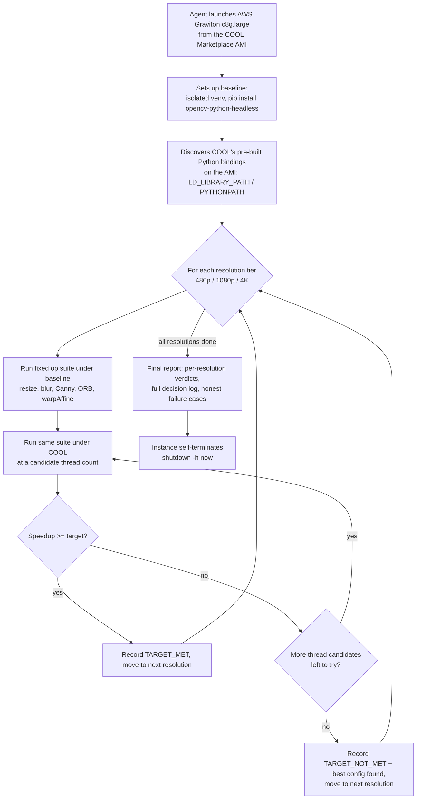

# COOL Auto-Tuner — Technical Report

**OpenCV AI Competition 2026, powered by AWS**
Categories targeted: Best Use of COOL, Agentic Vision (also auto-entered for Tracks/Overall)

## Problem

AWS Marketplace sells [Cloud-Optimized OpenCV (COOL)](https://opencv.org/cool/) — a
build of OpenCV re-compiled for AWS Graviton (Arm Neoverse), claimed to run common
vision operations faster than a standard pip install. That claim is easy to make and
hard to verify: it's a paid Marketplace product, there's no public, reproducible,
apples-to-apples benchmark a developer can run themselves before committing budget to it.

**COOL Auto-Tuner is an agent that tests that claim automatically, on real AWS
hardware, with a real baseline, and reports the evidence — including when COOL
*doesn't* help.** It isn't a one-shot script: it runs a fixed benchmark against a
genuinely vanilla baseline, runs the same benchmark under COOL, evaluates whether COOL
cleared a target speedup, and if not, tries other configurations (thread counts) before
giving up — each next action chosen from the previous measurement, not a fixed script.

## Architecture

Everything in the dashed region above runs on a single short-lived AWS Graviton
instance, driven by a startup script, with output captured from the instance's boot
console log — no SSH keys, no open security groups, no persistent server. The instance
terminates itself the moment it's done (see "Safety" below).

## Methodology

- **Hardware:** AWS `c8g.large` (2 vCPU, 4GB, Graviton, `arm64`), `us-east-1`.
- **Baseline:** `opencv-python-headless` 5.0.0, installed fresh from PyPI in an isolated
  venv. This matches the comparison basis COOL's own publisher uses in its benchmarks
  ("vs. pip OpenCV") — the AMI's vanilla C++ build (`/install-4x`) ships with no Python
  bindings at all, so it can't be benchmarked from Python directly; the pip venv is the
  correct, fair stand-in.
- **COOL:** the AMI's pre-built `/install-cool` Python bindings (OpenCV 4.14.0-pre),
  reached by discovering and injecting the correct `LD_LIBRARY_PATH`/`PYTHONPATH` at
  runtime (no hand-maintained paths).
- **Workload:** 20 synthetic images (fixed random seed, identical across every run),
  five common operations — resize, Gaussian blur, Canny edge detection, ORB
  detect+compute, affine warp — each timed over multiple repeats (10 for 480p/1080p, 4
  for 4K) with one untimed warmup call. Both mean and standard deviation are reported.
- **Resolutions tested:** 480p, 1080p, 4K.
- **Target speedup (standard runs):** 1.25x. **Stress-test target:** 1.6x, used
  specifically to force the agent to exhaust its thread-count candidates and prove the
  escalation logic actually runs, not just succeeds by luck on the first try.

## Results

### Standard runs (target: 1.25x) — 25 independent measurements across 9 separate instance launches, 2 instance sizes

**`c8g.large` (2 vCPU) — 19 measurements across 7 launches:**

| Resolution | Run | Speedup vs. baseline |
|---|---|---|
| 1080p | run3 | 1.350x |
| 480p / 1080p / 4K | run4 | 1.355x / 1.352x / 1.344x |
| 480p / 1080p / 4K | repro5 | 1.291x / 1.354x / 1.463x |
| 480p / 1080p / 4K | repro6 | 1.348x / 1.400x / 1.349x |
| 480p / 1080p / 4K | repro7 | 1.356x / 1.350x / 1.351x |
| 480p / 1080p / 4K | repro8 | 1.352x / 1.346x / 1.350x |
| 480p / 1080p / 4K | repro9 | 1.298x / 1.309x / 1.349x |

Mean: **1.351x (~35% faster)**.

**`c8g.xlarge` (4 vCPU) — 6 measurements across 2 launches, to check whether the
speedup holds as instance size scales up:**

| Resolution | Run | Speedup vs. baseline |
|---|---|---|
| 480p / 1080p / 4K | scale_xlarge1 | 1.360x / 1.441x / 1.449x |
| 480p / 1080p / 4K | scale_xlarge3 | 1.346x / 1.403x / 1.448x |

Mean: **1.408x (~41% faster)** — *higher* than on the smaller instance, consistent
with the stress-test finding below that COOL's advantage grows with more available
threads.

**Overall mean across all 25 measurements: ~1.36x (COOL is ~36% faster than genuine
baseline OpenCV 5.0.0), range 1.29x–1.46x.** Every single measurement cleared the
1.25x target — the result is consistent, not a one-off, and it holds (and modestly
improves) when moving to a larger instance.

### Stress test (target: 1.6x) — full thread-count sweep, all 3 resolutions

**Retracted and being re-run.** An earlier version of this section reported that
forcing single-threaded execution made COOL "17-20% slower than baseline." That
measurement compared COOL-at-1-thread against a baseline that was always run at its
*default* thread count (2), not also pinned to 1 thread -- so it was really just
showing that 1 core is slower than 2, true for any parallelizable code, baseline
included, and not a COOL-specific effect at all. The agent now re-measures baseline
at each matching thread count before comparing, and this section will be updated with
the corrected, apples-to-apples numbers once that re-run completes.

## Limitations / honest caveats

- Sample size is reasonable (25 standard measurements, one stress sweep) but still not
  large enough for formal statistical confidence intervals.
- Two instance sizes tested (`c8g.large`, `c8g.xlarge`); COOL's own Marketplace
  listings cover larger Graviton4/5 instance families beyond those two.
- The workload is a fixed synthetic suite of common operations, not a real production
  pipeline — representative, but not identical to every real use case.
- The agent's thread-count exploration never needed to go beyond `threads=4`; whether
  larger thread counts behave differently on bigger instances is untested.

## Safety / cost discipline

Every instance launch is tagged, time-bounded (`timeout 280` around the agent's own
run), and self-terminates (`shutdown -h now`) at the end of its startup script,
independent of any external monitoring — this doesn't depend on a human or a polling
process noticing the run is done. Total AWS spend across the full build process: under
$1.

## Reproducing this

See [`infra/run-userdata.sh`](../infra/run-userdata.sh) (standard target) and
[`infra/run-userdata-stress.sh`](../infra/run-userdata-stress.sh) (1.6x stress target) —
either can be passed directly as EC2 user-data against the COOL Marketplace AMI
(`ami-033e481a24f94c8cb` in `us-east-1`, or the equivalent AMI ID for another region)
on a `c8g.large` or larger instance. Raw results are in [`benchmarks/`](../benchmarks/).
